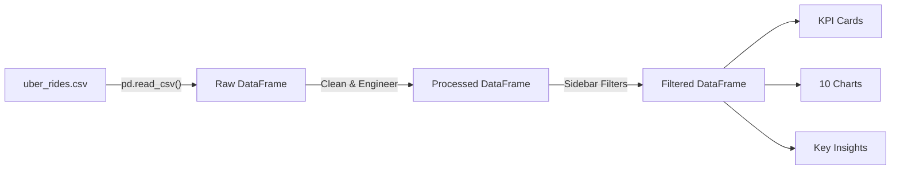

# 🚗 Uber Ride Analysis Platform — Complete Project Guide

---

## 1. How the Project Works

This is a **single-page Streamlit web dashboard** that loads a CSV of 10,000 Uber rides,
cleans and transforms the data, and renders interactive charts + business insights —
all in **one Python file** (`app.py`).



**Workflow in plain English:**

1. **Load** — `pandas` reads the CSV from `data/uber_rides.csv`.
2. **Preprocess** — duplicates removed, invalid values fixed, dates parsed, new features (Hour, Day, Month) created.
3. **Filter** — the user adjusts sidebar filters (date range, locations, payment type) and only matching rides are kept.
4. **Display** — KPI cards show summary stats, 10 Plotly charts visualise patterns, and auto-generated insights highlight the most important findings.

---

## 2. What Each File Does

| File | Purpose |
|------|---------|
| `app.py` | The **entire application** — data loading, preprocessing, filtering, charting, insights, and the Streamlit UI. |
| `requirements.txt` | Lists the 6 Python packages needed (`streamlit`, `pandas`, `numpy`, `matplotlib`, `seaborn`, `plotly`). |
| `data/uber_rides.csv` | Raw dataset: 10,000 Uber rides with 12 columns (Ride_ID, Date, Time, locations, distance, fare, etc.). |
| `README.md` | Setup guide, project structure, and feature overview. |

---

## 3. Data Flow Through the Application

```
CSV on disk
    ↓  pd.read_csv()
Raw DataFrame (10,000 rows × 12 columns)
    ↓  drop_duplicates()
    ↓  pd.to_datetime() on Date & Time
    ↓  pd.to_numeric() on Distance, Duration, Fare, Ratings
    ↓  replace invalid (≤ 0) with NaN → fill with median
    ↓  feature engineering: Hour, Day_of_Week, Month
Processed DataFrame (cached with @st.cache_data)
    ↓  sidebar filters applied
Filtered DataFrame
    ↓
    ├──→ KPI Cards  (Total Rides, Revenue, Avg Fare/Distance/Duration)
    ├──→ 10 Charts  (bar, histogram, pie via Plotly)
    └──→ Insights   (busiest hour/day/month, top locations, etc.)
```

> [!TIP]
> `@st.cache_data` ensures the CSV is loaded and cleaned only **once**. Subsequent sidebar
> filter changes re-run only the lightweight filter + render logic, making the app fast.

---

## 4. What Each Visualisation Shows

| # | Chart | What It Reveals |
|---|-------|-----------------|
| 1 | **Rides by Hour** | Which hours have the most rides (peak demand times). |
| 2 | **Rides by Day of Week** | Whether weekdays or weekends are busier. |
| 3 | **Rides by Month** | Seasonal demand patterns across the year. |
| 4 | **Top 10 Pickup Locations** | The most popular areas where passengers board. |
| 5 | **Top 10 Dropoff Locations** | The most common destinations. |
| 6 | **Fare Distribution** | How fares are spread — most common fare range, outliers. |
| 7 | **Distance Distribution** | Typical trip distances and how many are short vs. long. |
| 8 | **Average Fare by Hour** | Whether surge pricing or longer trips make certain hours more expensive. |
| 9 | **Avg Fare by Pickup Location** | Which pickup areas generate the highest fares. |
| 10 | **Payment Type Distribution** | Customer preference for Cash vs. Credit Card vs. UPI vs. Debit Card. |

---

## 5. Five Business Insights to Explain in an Interview

1. **Peak Demand Hours**
   "Ride demand peaks during morning rush (8–9 AM) and evening rush (5–7 PM). Uber can position more drivers in high-demand zones before these windows to reduce wait times and increase earnings."

2. **Location Hotspots**
   "Downtown and Midtown consistently rank as the top pickup and dropoff locations. This means these areas generate the most revenue and should be prioritised for driver allocation."

3. **Fare Pricing Patterns**
   "Average fare increases during late-night hours, suggesting either longer trips or surge pricing in effect. This is a revenue-maximisation opportunity."

4. **Payment Preferences**
   "Digital payments (Credit Card, Debit Card, UPI) together dominate over Cash. Uber should continue investing in seamless digital payment experiences."

5. **Day-of-Week Trends**
   "Weekdays tend to have more rides than weekends (commuter traffic). Weekend rides, however, may have higher average fares due to leisure trips being longer."

---

## 6. Ten Interview Questions & Answers

### Q1: What is this project about?
**A:** It's an interactive dashboard that analyses 10,000 Uber rides. It shows ride trends, location hotspots, fare patterns, and business insights using Python, Pandas, and Streamlit.

### Q2: Why did you choose Streamlit?
**A:** Streamlit lets me build a professional-looking web dashboard in pure Python with minimal code. It's perfect for data science projects because I can focus on analysis, not web development.

### Q3: How did you handle missing values?
**A:** I replaced missing numeric values (fare, distance, duration) with the **median** of that column. Median is more robust than mean because it isn't affected by outliers. I only dropped rows where the date couldn't be parsed, to avoid losing too much data.

### Q4: What is `@st.cache_data` and why did you use it?
**A:** It's a Streamlit decorator that caches the result of a function. When the user changes a filter, Streamlit re-runs the script, but `@st.cache_data` prevents the CSV from being re-loaded and re-cleaned every time. This makes the app much faster.

### Q5: How does the sidebar filtering work?
**A:** The sidebar creates filter widgets (date picker, multi-selects). I then apply boolean indexing on the DataFrame — e.g., `df[df['Pickup_Location'].isin(selected)]`. Only matching rows pass through, and all charts/KPIs update automatically.

### Q6: Why did you use Plotly instead of Matplotlib?
**A:** Plotly creates **interactive** charts — users can hover for exact values, zoom, and pan. Matplotlib produces static images. However, my code has a fallback: if Plotly isn't installed, it automatically uses Matplotlib/Seaborn so the app still works.

### Q7: What feature engineering did you do?
**A:** I extracted **Hour**, **Day of Week**, and **Month** from the Date and Time columns. These time-based features are essential for analysing demand patterns — e.g., "Which hour is busiest?" can only be answered if we have an Hour column.

### Q8: How would you improve this project with more time?
**A:** I would add: (1) a map visualisation showing pickup/dropoff locations, (2) a simple fare prediction model using Linear Regression, (3) a cancelled-ride analysis, and (4) deployment on Streamlit Cloud or Render.

### Q9: What business decisions can be made from this dashboard?
**A:** Fleet managers can use it to: allocate more drivers during peak hours, position drivers near high-demand pickup zones, set dynamic pricing based on hourly fare trends, and optimise payment options based on customer preferences.

### Q10: How does the data flow from CSV to charts?
**A:** CSV → `pd.read_csv()` → cleaning (remove duplicates, fix types, handle NaN) → feature engineering → cached DataFrame → sidebar filters reduce rows → filtered DataFrame feeds into KPI calculations, Plotly charts, and insight generators.

---

> [!IMPORTANT]
> **To run the project:**
> ```bash
> cd uber-ride-analysis
> pip install -r requirements.txt
> streamlit run app.py
> ```
